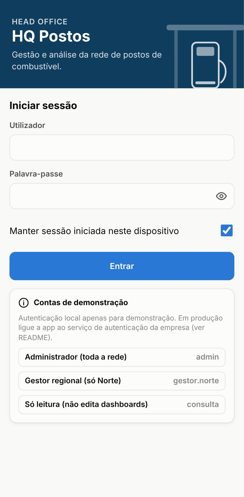
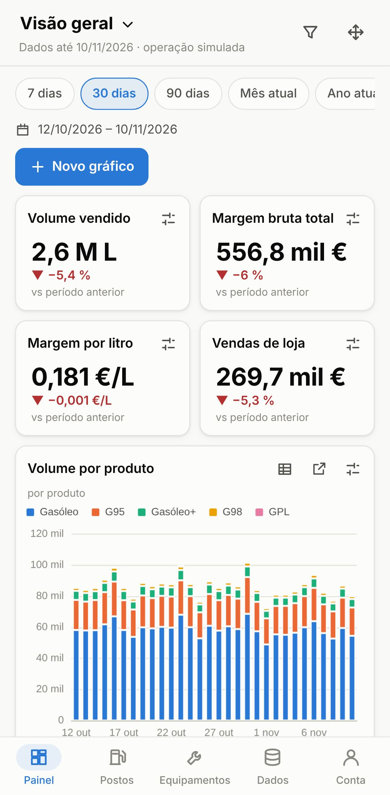
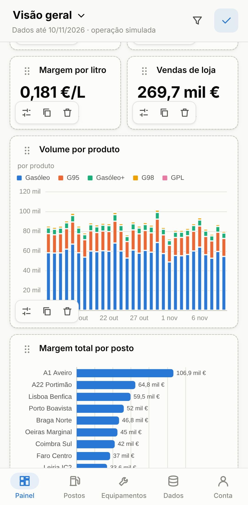
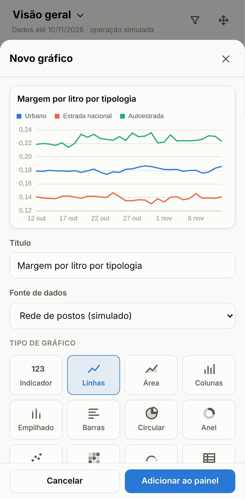
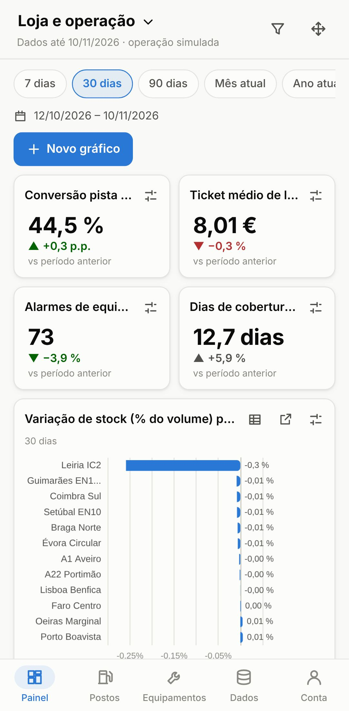
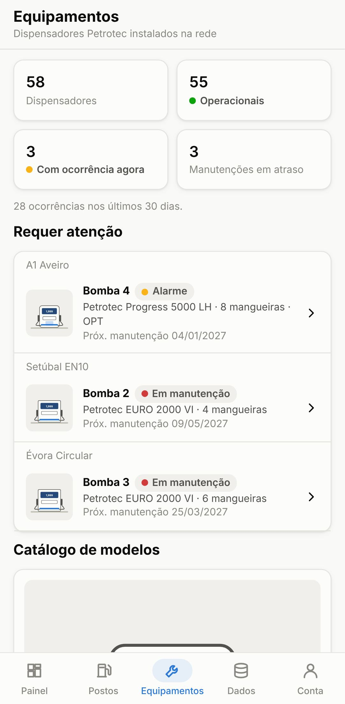
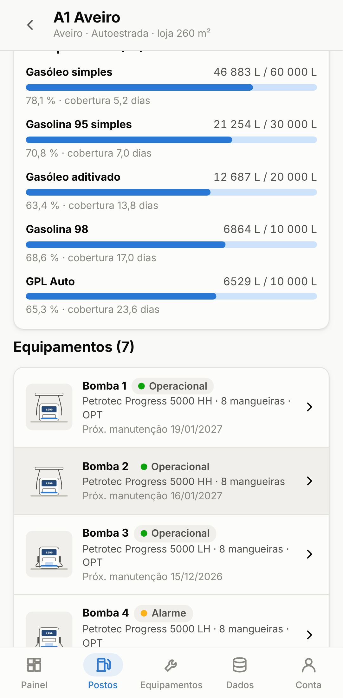

# HQ Postos — dashboard de Head Office para postos de combustível (Android)

App móvel (Android) para a sede acompanhar uma rede de postos: vendas de combustível, preços e margens, loja, stock nos tanques e estado dos equipamentos Petrotec. Os painéis são **personalizáveis**: cada gráfico pode ser movido, redimensionado e reconfigurado, e é possível construir gráficos novos à medida.

> ⚠️ **Dados:** os preços de referência nacionais vêm de valores publicados (fontes secundárias, ver [DADOS.md](DADOS.md)); **toda a operação da rede é simulada** (postos fictícios). Ligue a app aos sistemas da empresa antes de a usar em decisões.

| Login | Painel | Editar (mover/redimensionar) | Construtor de gráficos |
|---|---|---|---|
|  |  |  |  |

| Variação de stock | Equipamentos Petrotec | Detalhe de posto |
|---|---|---|
|  |  |  |

## Funcionalidades

- **Login** com perfis: administrador (toda a rede), gestor regional (só a sua região) e consulta (só leitura). Bloqueio temporário após 5 tentativas falhadas; sessão de 12 h.
- **Painéis personalizáveis** (3 predefinidos: Visão geral, Combustível e preços, Loja e operação; pode criar mais):
  - **Mover e redimensionar** gráficos (modo «Editar painel»: arrastar pela pega ⋮⋮ e pelo canto inferior direito; ou tamanhos rápidos Pequeno/Médio/Grande/Largura total). A disposição é guardada por utilizador e por tamanho de ecrã.
  - **Tipo de gráfico**: indicador (KPI), linhas, área, colunas, empilhado, barras (ranking), circular, anel, dispersão, mapa de calor, medidor e tabela.
  - **Escala**: linear, logarítmica, índice base 100, % do total; mínimo/máximo do eixo automático, zero ou valor fixo.
  - **Período**: 7/30/90 dias, mês, trimestre, ano atual, 12 meses, tudo ou datas à escolha — no painel inteiro ou só num gráfico; granularidade dia/semana/mês/trimestre; comparação com período anterior ou ano anterior; zoom temporal.
  - **Construtor de gráficos**: escolher métrica (22 indicadores), dimensão do eixo (tempo, posto, produto, região, tipologia, dia da semana, hora), desagregação em séries, filtros próprios, ordenação e nº de séries antes de agrupar em «Outros». Pré-visualização em tempo real.
  - Cada gráfico tem **vista de tabela** e vista **expandida**.
- **Postos**: lista com indicadores dos últimos 30 dias, alertas de tanques e equipamentos; detalhe com níveis dos tanques, bombas e ocorrências.
- **Equipamentos**: catálogo de modelos Petrotec (Progress 5000 LH/HH, Progress 1000 R, Progress LPG, EURO 2000 VI) com imagem, características e ligação à fonte; parque instalado com estado, disponibilidade a 90 dias, totalizador e manutenções em atraso.
- **Dados**: explicação do que é real/simulado, tabela de fontes dos preços, e **importação de CSV** (formato português) para criar gráficos com os seus próprios dados — por exemplo, exportações do portal de preços da DGEG.
- Tema claro/escuro, interface em português, pensada para telemóvel (funciona também em tablet/desktop).

## Experimentar

Requisitos: Node.js 22.

```bash
cd fuel-hq
npm ci          # o .npmrc usa legacy-peer-deps (contorna um erro do npm com dependências opcionais do vitest)
npm run dev     # abre em http://localhost:5173
npm test        # testes unitários (motor de consulta, autenticação, CSV, escalas, layouts)
```

Contas de demonstração (também aparecem no ecrã de login):

| Utilizador | Palavra-passe | Perfil |
|---|---|---|
| `admin` | `HeadOffice#2026` | Administrador, toda a rede |
| `gestor.norte` | `Norte#2026` | Gestor regional (Norte) |
| `consulta` | `Consulta#2026` | Só leitura |

## Gerar a app Android (APK)

**Pelo GitHub Actions:** o workflow [`.github/workflows/fuel-hq-android.yml`](../.github/workflows/fuel-hq-android.yml) corre os testes, faz o build e gera `app-debug.apk`, disponível como *artifact* «hq-postos-debug-apk» na execução do workflow. Instale-o no telemóvel (é preciso permitir a instalação de apps de origem desconhecida).

**No seu computador:** precisa de JDK 21 e do Android SDK (plataforma 36), por exemplo via Android Studio.

```bash
cd fuel-hq
npm run cap:sync              # build web + copia para android/
npx cap open android          # abre no Android Studio (Run ▶ para um telemóvel ligado por USB)
# ou, só por linha de comandos:
cd android && ./gradlew assembleDebug   # APK em android/app/build/outputs/apk/debug/
```

Para publicar na Google Play é preciso um build *release* assinado com a chave da empresa (não incluído).

A app é construída com **Capacitor** (React + TypeScript dentro de um WebView nativo). Não foi possível compilar o APK no ambiente onde o código foi escrito (o SDK Android não estava acessível); a compilação é feita e verificada pelo workflow de CI.

## Imagens dos equipamentos Petrotec

A app **não inclui fotografias da Petrotec**: são material com direitos de autor e não foi possível descarregá-las neste ambiente. Até as acrescentar, mostra ilustrações genéricas originais. Há duas formas de usar as imagens oficiais (obtenha-as junto da Petrotec ou confirme que a empresa tem direito a usá-las):

1. **Distribuídas com a app (recomendado):** copie os ficheiros para `fuel-hq/public/equipment/` e registe-os em `public/equipment/manifest.json`:
   ```json
   { "images": { "p5000-lh": "p5000-lh.jpg", "p5000-hh": "p5000-hh.jpg", "progress-lpg": "progress-lpg.png" } }
   ```
   Ids disponíveis: `p5000-lh`, `p5000-hh`, `p1000r`, `progress-lpg`, `euro2000-vi`.
2. **No telemóvel:** em Equipamentos → modelo → «Alterar imagem do equipamento», tire/escolha uma fotografia ou indique um endereço `https://` da imagem. Fica guardado só nesse dispositivo.

## Passar para produção

- **Autenticação:** a autenticação incluída é **local e só para demonstração** (palavras-passe com PBKDF2 no código; qualquer verificação feita só no telemóvel pode ser contornada). Implemente a interface `AuthService` (`src/auth/authService.ts`) contra o fornecedor de identidade da empresa (ex.: OpenID Connect com PKCE) e valide permissões no servidor.
- **Dados reais:** substitua `simulate()` (`src/data/simulate.ts`) por uma chamada à API do back-office que devolva o mesmo formato `Dataset` (linhas diárias por posto × produto e por posto). Todo o resto (painéis, construtor, filtros) funciona sem alterações. Para preços oficiais, use a série da DGEG em vez dos pontos de `referencePrices.ts`.
- **Armazenamento:** painéis, imagens e CSV importados ficam no armazenamento local do WebView (por dispositivo). Para partilhar painéis entre utilizadores/dispositivos é preciso guardá-los no servidor.
- **Segurança de dependências:** `npm audit` reporta um aviso moderado (`uuid` via `@capacitor/cli` → `xcode`), usado apenas nas ferramentas de build para iOS; não entra na app Android.

## Estrutura

```
fuel-hq/
├── src/
│   ├── auth/            autenticação (interface + implementação local de demonstração)
│   ├── data/            catálogo (postos, produtos, modelos Petrotec), preços de referência,
│   │                    simulador, métricas, motor de consulta, importação CSV
│   ├── dashboard/       grelha arrastável (react-grid-layout), widgets, opções ECharts, construtor
│   ├── pages/           Login, Postos, Equipamentos, Dados, Conta
│   └── components/      ícones, folha modal, ilustrações
├── public/equipment/    imagens oficiais dos equipamentos (manifest.json)
├── android/             projeto nativo gerado pelo Capacitor
├── tests/               testes unitários (Vitest)
└── DADOS.md             fontes, pressupostos e o que é simulado
```

Bibliotecas principais: React 19, ECharts 6, react-grid-layout 2, Capacitor 8, Vite 8.

## Limitações conhecidas

- As ligações externas (fontes, páginas Petrotec) devem abrir no navegador do telemóvel; confirme o comportamento no seu dispositivo.
- O mapa de calor por hora usa perfis horários assumidos por tipologia (a simulação é diária).
- «Conversão pista → loja» é um rácio aproximado (ver DADOS.md).
- Semanas/meses incompletos nas pontas do período aparecem marcados com «*» e com cor mais clara nas colunas.
